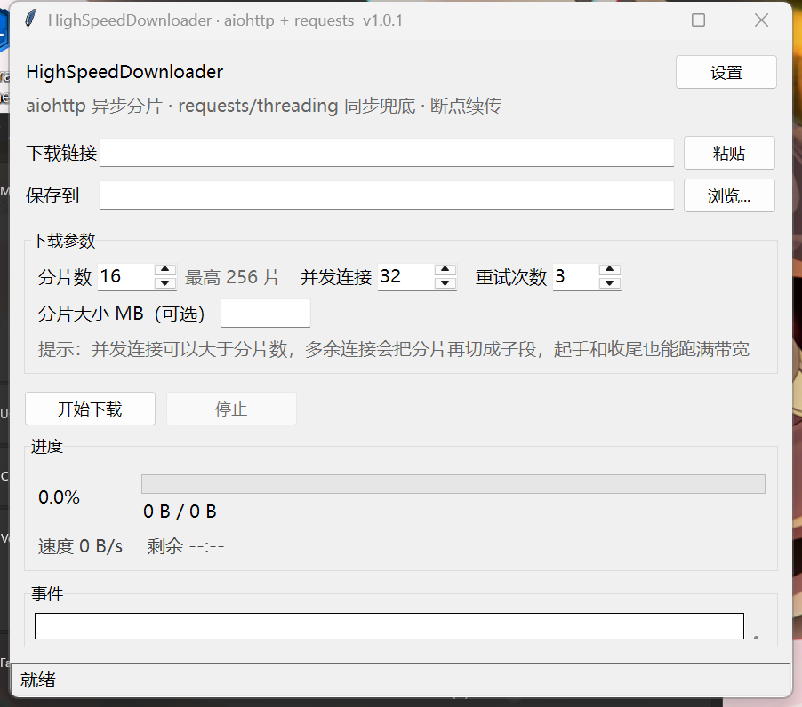

# HighSpeedDownloader · 高速分片下载器

面向 Windows 的图形化多线程分片下载工具：**aiohttp 异步分片下载 + requests/threading 同步兜底**，支持断点续传、并发控制、失败分片隔离与降级日志。下载引擎自己实现，不封装 aria2 / wget 等任何外部程序。

[](../../releases/latest)
[](#系统要求)
[](https://www.python.org/)
[](LICENSE)

免安装，单文件 EXE，目标机器**不需要安装 Python**。



## 目录

- [下载与安装](#下载与安装)
- [功能特性](#功能特性)
- [界面与参数](#界面与参数)
- [设置与记忆](#设置与记忆)
- [证书与代理](#证书与代理tls-拦截)
- [断点续传](#断点续传与临时文件)
- [工作原理](#工作原理)
- [常见问题](#常见问题)
- [从源码运行](#从源码运行)
- [自行打包](#自行打包)
- [项目结构](#项目结构)
- [已知限制](#已知限制)
- [许可证](#许可证)

## 下载与安装

前往 **[Releases](../../releases/latest)** 下载 `HighSpeedDownloader.exe`（约 20 MB），双击即用。

| 项 | 说明 |
| --- | --- |
| 系统要求 | Windows 10 / 11（x64）；无需 Python、无需运行库 |
| 安装 | 免安装，单个 exe，可放在任意目录 |
| 首次启动 | 自解压运行时到临时目录，约 2–4 秒 |
| 卸载 | 删除 exe；如需彻底清理，再删除 `%APPDATA%\HighSpeedDownloader` |

> **SmartScreen 提示**：本程序未做代码签名，Windows 可能提示“Windows 已保护你的电脑”。点 **更多信息 → 仍要运行** 即可；也可自行从源码打包（见[自行打包](#自行打包)）。
>
> 部分杀毒软件会把 PyInstaller 打包的程序误报为可疑，属打包器常见误报，可加入信任列表。

## 功能特性

- **异步分片**：aiohttp + `asyncio.Semaphore` 严格限制并发连接数，避免瞬间打满源站或本地端口。
- **两级降级**：
  - 服务端不支持 Range → 整体降级为 requests + threading 单连接同步下载；
  - 单个分片异步多次失败 → 只把该分片切到同步线程兜底，其他分片不受影响。
- **并发与分片解耦**：并发连接数可以大于分片数，剩余名额会把分片再切成子段并发下载，起手更快。
- **连接轮换**：每条连接一次最多负责 8 MB，下完即换新连接，避免 CDN 长连接“越下越慢”拖死收尾。
- **断点续传**：分片独立临时文件，启动时自动跳过已完成分片；改分片参数仍可沿用旧布局续传。
- **真实文件名**：粘贴链接后自动探测跳转与 `Content-Disposition`，把真实文件名填进“保存到”。
- **设置记忆**：分片数、并发、重试、分片大小、默认保存目录在关闭窗口时自动保存。
- **进度与日志**：实时百分比、已下载/总大小、瞬时速度、剩余时间，降级事件单独打印。
- **证书友好**：默认信任 Windows 证书库，解决公司代理 / 杀毒软件 / 加速器替换 HTTPS 证书导致的 `CERTIFICATE_VERIFY_FAILED`。

## 界面与参数

| 界面项 | 说明 |
| --- | --- |
| 设置 | 右上角入口：默认保存目录 + HTTPS 证书信任方式 |
| 下载链接 | 支持 http/https；粘贴后自动解析真实文件名 |
| 保存到 | 保存目录 + 解析出的文件名；可浏览或手工改名，已存在会二次确认覆盖 |
| 分片数 | 断点与合并粒度：`chunk = max(0.5 MB, ceil(总大小 / 分片数))`；旁边常驻“最高 N 片”提示 |
| 并发连接 | 同时建立的最大连接数，默认 32、上限 256；**可以大于分片数** |
| 重试次数 | 每分片总尝试次数 = 重试 + 1，异步与同步兜底共用 |
| 分片大小 MB | 可选，填写后覆盖“分片数”的计算结果 |

### 分片数与并发上限

- 分片数默认 16，硬上限 **256** 片，且每片不小于 0.5 MB；探测到总大小后，“最高 N 片”会按 `min(256, ceil(总大小 / 0.5 MB))` 更新。
- 并发连接数默认 **32**、上限 **256**，与分片数解耦。
- 超过分片上限**不拦截**：按输入继续，只把提示变橙并在事件区警告；若被限速或遇到 429 再调低。

## 设置与记忆

- 关闭窗口时自动记住：分片数、并发连接、重试次数、分片大小 MB、默认保存目录；下次启动原样恢复。
- 下载链接与“保存到”里的文件名**不记忆**；填入链接后自动按“保存目录 + 真实文件名”生成。
- 配置持久化在 `%APPDATA%\HighSpeedDownloader\config.json`，设置窗口会显示实际路径；删除该文件即恢复默认。
- **默认保存目录**取系统“下载”目录：即使用户把“下载”重定向到其他盘也能识别，取不到时退回 `~/Downloads`。
- 手工改过文件名后，后续解析结果不会覆盖你的输入。

## 证书与代理（TLS 拦截）

- **症状**：`SSLError(... [SSL: CERTIFICATE_VERIFY_FAILED] certificate verify failed: unable to get local issuer certificate ...)`。
- **原因**：公司代理、杀毒软件、网游加速器（如 SteamTools）在本机安装了自己的根证书解密 HTTPS；requests 默认只信任内置 certifi，不读 Windows 证书库，而浏览器信任系统库。
- **默认行为**：设置里的 **信任 Windows 证书库** 默认开启。requests 通过自定义 `HTTPAdapter` + `ssl.create_default_context()` 使用系统根证书（不落地证书文件），aiohttp 默认上下文同样信任系统库，两者与浏览器一致。
- 关闭该选项则回退到 certifi（更严格，但会重新出现上述报错）。
- 仍然失败时：把公司/代理的根证书导入“受信任的根证书颁发机构”后重开程序；或检查系统时间。
- 代理走 `HTTP_PROXY` / `HTTPS_PROXY` / `NO_PROXY` 环境变量，本工具不内置代理设置。

## 断点续传与临时文件

临时文件统一收在目标文件旁边的 **`<output>.parts\` 子目录**，下载目录不会散落一堆分片：

| 文件 | 何时出现 | 内容 |
| --- | --- | --- |
| `<output>.parts\part.<index>` | 分片下载期间 | 第 index 片的原始字节 |
| `<output>.parts\meta.json` | 第一次分片下载时写一次 | URL / 输出路径 / 总大小 / 分片大小 / 分片数 / 版本，用于校验断点归属 |
| `<output>.parts\merging` | 合并阶段 | 按偏移拼接的中间文件，`os.replace` 成功后即消失 |
| `<output>.parts\single.part` | 整体单连接模式 | 整份下载内容，成功后 `os.replace` 成目标文件 |

删除时机：

- **成功合并后**：`os.replace` 完成 → 删除 `.parts\` 下的分片与 `meta.json`，空目录一并移除。
- **整体单连接成功后**：`single.part` 重命名为目标文件，同时清掉 `meta.json` 与空目录。
- **主动停止 / 失败退出**：**不删除**，保留断点，下次同一 URL + 同一输出路径可续传；程序不会清理与本次任务无关的文件。

其他约定：

- 启动时自动扫描已完成分片并跳过。
- **改了分片数 / 分片大小也能续传**：只要下载地址、保存路径、文件总大小一致，会沿用上次的分片布局。
- `meta.json` 被误删时：若残留分片能反推出唯一布局则续传，否则安全中止，绝不用错误偏移拼文件。
- 服务器文件变了或临时文件属于另一个任务时，拒绝续传并说明原因。
- 合并阶段需要约 2 倍目标大小的可用磁盘空间。

## 工作原理

1. **探测**：HEAD 读取 `Content-Length` / `Accept-Ranges`；HEAD 被禁（405/501）或信息不足时，用 `GET Range: bytes=0-0` 复核，只有实测 206 才认为支持分片。
2. **无总长度**：退化为单连接整体下载并提示不支持断点续传。
3. **异步分片**：aiohttp + `asyncio.Semaphore(并发连接数)`；名额够时把分片切成子段并发下载，每片/每子段独立重试，`Content-Range` 逐段校验。
4. **单片兜底**：某片异步多次失败，只把该片切到 requests + threading 独立线程重下。
5. **整体降级**：任一分片收到 200（服务端忽略 Range）时，整体降级为 requests 单连接同步流式下载，并打印降级日志。
6. **合并**：全部分片完成后按偏移合并到 `<output>.merging`，`fsync` 后 `os.replace` 原子替换目标文件，再清理临时分片与元数据。

降级事件会在事件区单独打印，例如：

```
服务端不支持 Range 分片，整体降级为 requests + threading 单连接同步下载
分片 3 异步重试 3 次仍失败，切换同步线程兜底
```

## 常见问题

**下载速度前快后慢？**
部分 CDN 会按 IP 累计限速。程序已做连接轮换，但仍可能受服务端策略影响；把并发降到 8–16 通常更稳。

**提示 403 / 跳转登录页？**
CDN 反爬或链接需要 Cookie/Referer，也可能签名过期；浏览器 UA 只能解决一部分。

**支持 macOS / Linux 吗？**
当前只面向 Windows（GUI 使用 tkinter，打包为 Windows exe）。源码理论上可在其他平台运行，但未做适配与验证。

**命令行 / 批量下载？**
没有。本工具的图形界面是唯一入口，参数仅供界面内部调用。

**下载到一半关掉程序会怎样？**
已下载分片保留在 `<output>.parts\`，重新打开、填同一个链接与保存路径即可续传。

## 从源码运行

要求 Python 3.9+（开发环境实测 3.14），tkinter 由 Windows 官方安装包自带。

```powershell
git clone <your-repo-url>
cd high-speed-downloader
pip install -r requirements.txt
python high_speed_downloader.py
# 或
pythonw high_speed_downloader.py   # 不显示控制台
```

Windows 也可以双击 `start.bat`。

## 自行打包

```powershell
pip install pyinstaller
powershell -NoProfile -ExecutionPolicy Bypass -File .\build_exe.ps1
# 产物：dist\HighSpeedDownloader.exe
```

打包参数为 `--onefile --windowed --noupx`，内嵌 aiohttp / requests 的 DLL 与 Tcl/Tk，不依赖系统 Python。版本号需在 `version_info.txt` 与源码 `APP_VERSION` 两处同步修改。

## 项目结构

```
high-speed-downloader/
├─ high_speed_downloader.py  # 源码：GUI + 下载引擎（含完整注释）
├─ build_exe.ps1             # 一键打包脚本
├─ HighSpeedDownloader.spec  # PyInstaller 配置
├─ version_info.txt          # EXE 版本资源
├─ requirements.txt          # 运行依赖
├─ start.bat                 # 源码一键启动
├─ download-arrow.ico        # 程序图标
├─ gui_preview.png           # 界面截图
└─ tools/                    # 开发期自测脚本（不属于发行物）
   ├─ test_server.py         # 本地测试服务：Range / 不支持 Range / 故障注入 / 限速
   ├─ run_headless.py        # 场景验证：range / subsplit / norange / flaky / resume
   ├─ run_settings_test.py   # 设置、记忆、上限、证书开关共 13 项
   ├─ frozen_selftest.py     # 冻结环境自检（打包后验证无 Python 可运行）
   ├─ download_real.py       # 真实外网 URL 验收 + 首尾字节抽样比对
   └─ screenshot_gui.ps1     # 启动 GUI 并截图
```

## 已知限制

- 只支持单个文件下载，不支持整站抓取、磁力链或分卷压缩包自动合并。
- 服务端不支持 Range 时只能单连接下载，无法续传。
- 合并阶段需要双倍磁盘空间。
- 未做代码签名，首次运行可能触发 SmartScreen 提示。
- 分片数与并发数过高时可能触发源站限速（建议并发 8–16）。

## 许可证

[MIT](LICENSE)

## English

HighSpeedDownloader is a Windows GUI downloader with aiohttp-based async chunked downloading and a requests/threading fallback. It supports resumable downloads, configurable concurrency, per-shard retry with isolated degradation, real-time progress, and a single-file `HighSpeedDownloader.exe` that runs without Python installed.

Download the latest `HighSpeedDownloader.exe` from [Releases](../../releases/latest), double-click to run, paste a URL, and start downloading.
